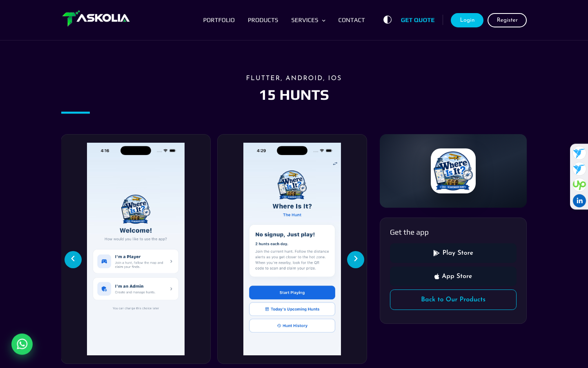
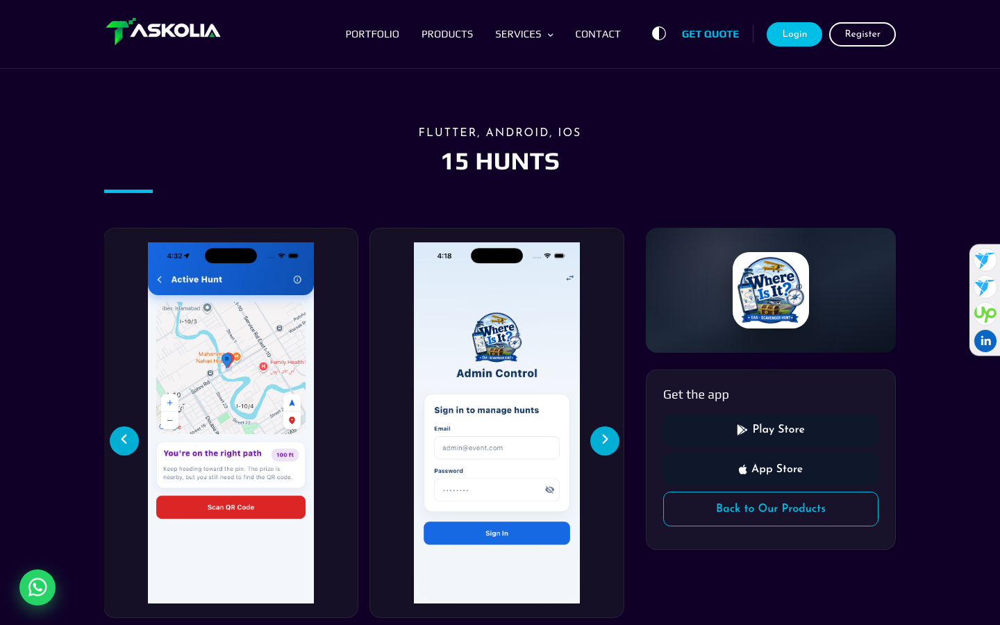
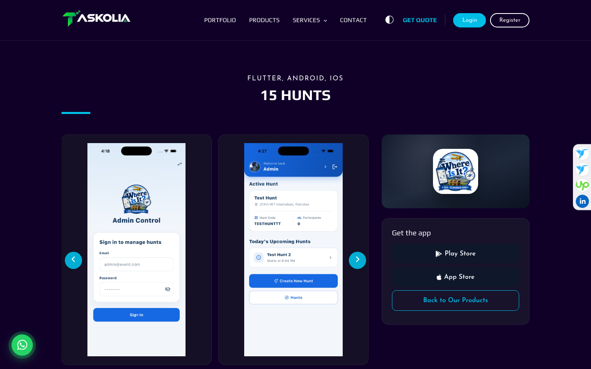
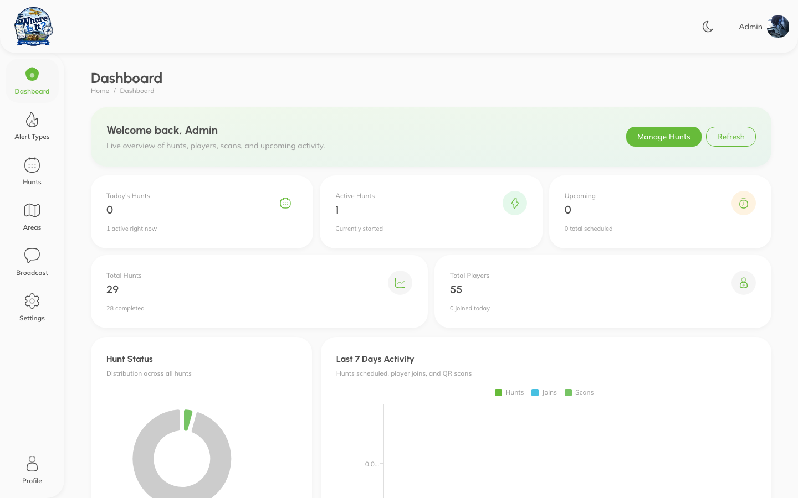
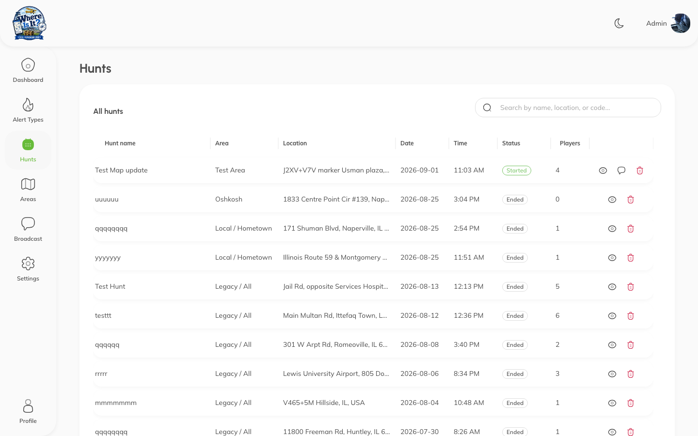
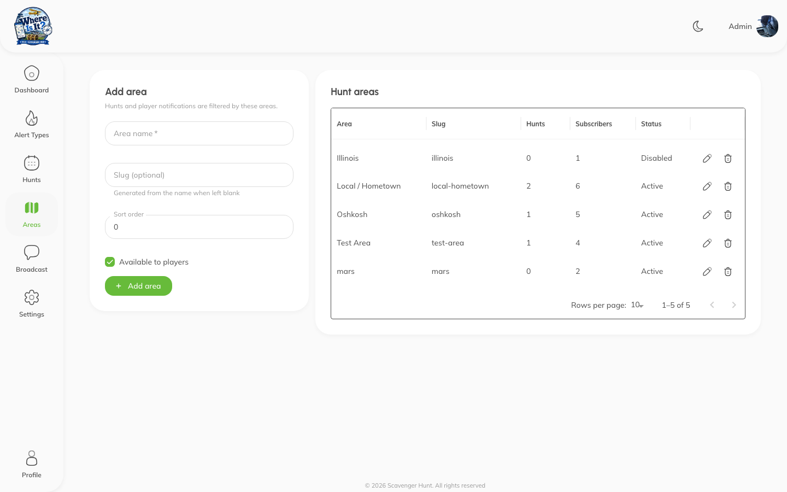
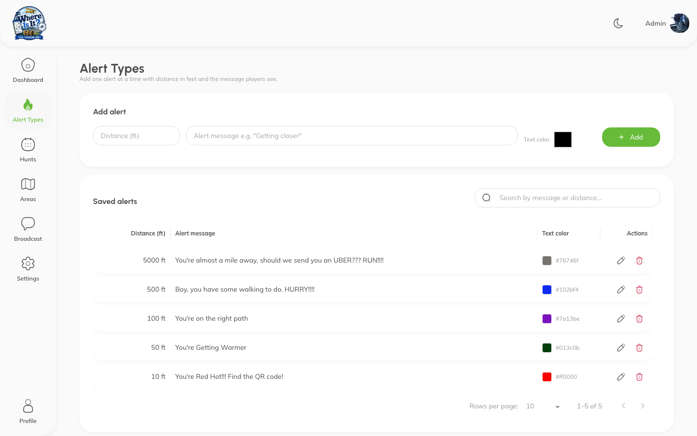

# Realtime Scavenger Hunt Platform

Location-based **scavenger hunt** backend + admin panel: organizers hide a prize at GPS coordinates, players follow distance clues on a mobile app, and the **first QR scan** at the hotspot wins.

> Focus of this repo: **backend APIs, realtime workers, Redis/MQTT live state, and admin panel**. Mobile client consumes these APIs / MQTT topics.

---

## The product idea

1. Admin creates a hunt for a specific **area** with a **lat/lng prize point**, clue text, nearby radius, date/time, and a unique **event code**.
2. A **QR code** is generated for that hunt and placed with the physical gift.
3. Players open the app (no heavy signup friction), join today’s hunts, and share **live GPS**.
4. As they move, the backend computes distance and fires **proximity alerts** (e.g. getting hotter as they approach).
5. At the location they **scan the QR** — first successful scan is ranked #1 and can claim the prize.
6. Admin watches **live map positions**, joins, scans, and can broadcast messages / push notifications.

---

## Why the stack is this “fit”

| Concept | Why it matters here |
|---------|---------------------|
| **GPS + Haversine distance** | Convert player lat/lng vs prize point into feet for “nearby” / alert thresholds |
| **MQTT (EMQX)** | Low-latency player location publish + admin live map / live stats topics |
| **Redis** | Ephemeral live presence (TTL), geo sets, scan/join counters, hunt meta cache |
| **BullMQ + Redis** | Schedule hunt auto-start, “starting soon” reminders, recover overdue jobs |
| **QR scan race** | Atomic first-scan ranking + winner / claim flow |
| **FCM push** | Notify admins/players (first scan, hunt starting, broadcasts) |
| **JWT (+ MQTT auth tokens)** | Secure admin session and scoped MQTT credentials for players vs admin |
| **PostgreSQL + Prisma** | Durable hunts, participants, areas, alert types, claims |

Without realtime MQTT + Redis TTL, a GPS hunt feels laggy and “ghost players” stay on the map. Without QR race handling, two people can both think they won.

---

## Architecture (high level)

```
Mobile app  --GPS-->  MQTT (EMQX)  --worker-->  Redis live state
    |                      |                         |
    |                  publish live              admin map / stats
    |                  positions / stats
    |
    +------ REST/JSON APIs (Next.js) ------+------ Admin panel (MUI)
                |                                    |
           PostgreSQL                           create hunts,
           Prisma                               areas, alerts,
                                                broadcasts
                |
           BullMQ workers (hunt start / reminders)
```

Workers:

- `worker:mqtt-live` — subscribe to player location topics, update Redis, refresh live stats, publish retained admin snapshots
- `worker:hunt-start` — BullMQ schedules auto-start + reminder pushes for scheduled hunts

---

## Screenshots

### Mobile experience
| | |
|--|--|
| App overview |  |
| Hunt flow |  |
| Map / alerts |  |

### Admin panel
| | |
|--|--|
| Dashboard |  |
| Hunts |  |
| Areas |  |
| Alert types |  |

---

## Core domain features

### Hunt lifecycle
- Create hunt: name, location string, **latitude/longitude**, date/time/timezone, clue, nearby radius, area
- Statuses: `SCHEDULED` → `STARTED` → `ENDED`
- Auto-start via queue at event time; overdue recovery on worker boot
- QR code URL generated per hunt / event code

### Players & participation
- Join active hunt by code / device id
- Live GPS stream over MQTT while hunt is started
- Proximity alert types (distance in feet + message/color)
- QR scan API records rank; first scan triggers admin push
- Prize claim statuses: `NONE` / `WAITING` / `CLAIMED`
- Hunt history for players

### Live ops (admin)
- Dashboard KPIs: today’s / active / upcoming hunts, players, scans
- Hunts CRUD + end hunt
- Areas (geo regions players can subscribe to)
- Alert types configuration
- Broadcast messaging + FCM test/broadcast endpoints
- Live positions API / MQTT admin topics (players do **not** receive everyone’s GPS)

### Security / realtime auth
- Admin JWT cookie/session for dashboard APIs
- MQTT auth tokens scoped by role (`player` | `admin`) and hunt
- Player MQTT topics are write-location / read limited; admin gets live map snapshot topic

---

## API surface (examples)

**Player / hunt**
- `POST /api/hunts/join`
- `POST /api/hunts/scan` — QR race + rank
- `GET /api/hunts/active`, `GET /api/hunts/history`
- `GET /api/hunts/[id]/live-positions`
- `POST /api/hunts/[id]/first-place/claim`
- `GET /api/player/areas`, proximity alert templates

**Admin**
- Dashboard, hunts CRUD, areas, alert types, settings, profile
- Push broadcast / test
- Swagger: `/admin/api-docs` and `/user/api-docs`

---

## Tech stack

| Layer | Choice |
|-------|--------|
| App / Admin UI | **Next.js**, React, **MUI**, Tailwind |
| API | Next.js App Router route handlers |
| DB | **PostgreSQL** + **Prisma** |
| Cache / queues | **Redis**, **BullMQ**, **ioredis** |
| Realtime | **MQTT** (`mqtt` client) + **EMQX** |
| Geo | Haversine distance (feet) |
| Auth | **JWT** (`jose`), bcrypt |
| Push | **Firebase Admin** (FCM) |
| QR | `qrcode` |
| Maps (admin) | Leaflet |
| Docs | Swagger UI / OpenAPI |
| Deploy | Docker Compose (Postgres, Redis, EMQX, app, workers) |

---

## Local setup

```bash
npm install
cp .env.example .env
# set DATABASE_URL, JWT_SECRET, REDIS_URL, MQTT_URL
npm run db:setup
npm run dev
```

Workers (separate terminals):

```bash
npm run worker:hunt-start
npm run worker:mqtt-live
```

Or full stack:

```bash
docker compose up -d
```

Default seeded admin (local): `admin@gmail.com` / `admin1`
